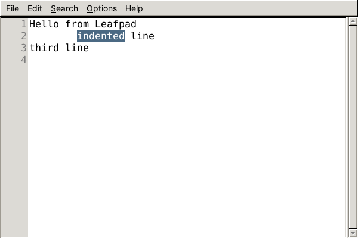
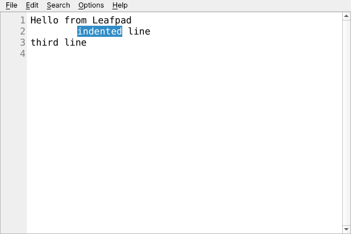
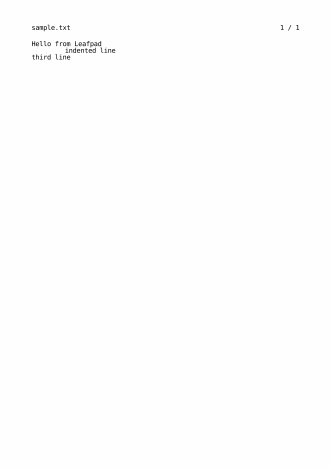
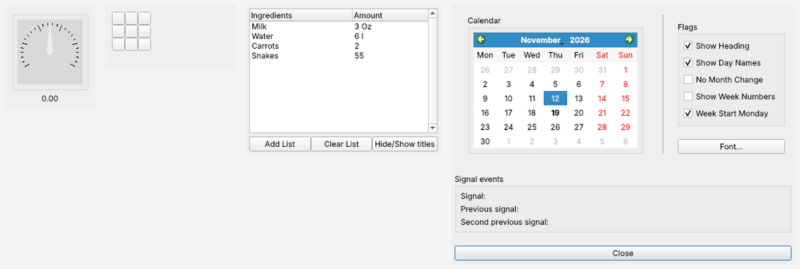
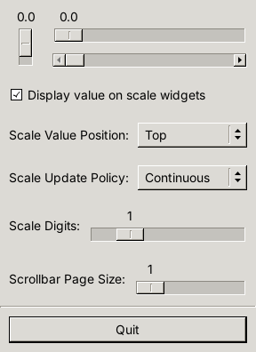
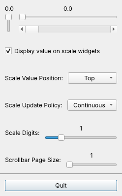

# GTK made Qt

Compile GTK 1.2, GTK 2, GTK 3 and GTK 4 programs - unmodified, as plain C -
and run them on Qt 6 (or Qt 5.15). No GTK is needed to build or to run them:
the programs become ordinary Qt applications that follow the desktop's Qt
style and run natively on Wayland, X11, Windows and macOS.

Copyright (C) 2010-2014 Johan Thelin, Robin Burchell (gqt) and contributors.
Licensed under the LGPL 2.1 or later with a static linking exception; see
[COPYING](COPYING).

| Leafpad, real GTK 2 | Leafpad, same source on GTK made Qt |
| --- | --- |
|  |  |

[Leafpad](https://github.com/tarot231/leafpad), a GTK 2 text editor, built
from its unmodified source with its own autotools build: menus from a
GtkItemFactory, line numbers that Leafpad draws itself with GdkGC and Pango
into a GtkTextView border window, search highlighting, its own undo,
GtkFileChooser with Leafpad's encoding selector, font dialog and printing
(GtkPrintOperation, here to PDF):



GTK 1.2: programs from the GTK 1.2 tutorial, including custom widget
classes written the GTK 1 way (`gtk_type_unique`, `realize` and
`expose_event` drawing with GDK), GtkCList and GtkCalendar:



## Quick start

```bash
cmake -B build && cmake --build build -j8 && ctest --test-dir build
```

```bash
./bgqt.sh gtk2/gcif          # a 2007 GTK 2 program, untouched, on Qt 6
```

```bash
./bgqt.sh gtk4/application
```

Building an existing project: run its build under `gtk-made-qt-env`, which
points pkg-config (`gtk+-2.0`, `gtk+-3.0`, `gtk4`, `gtk+`), `gtk-config`
and the linker at the library:

```bash
build/gtk-made-qt-env ./configure
```

```bash
build/gtk-made-qt-env make
```

The finished program depends on Qt, GLib, cairo and Pango - not on GTK and
not on GTK made Qt (the library is static). See
[docs/user-guide.md](docs/user-guide.md) and
[docs/packaging.md](docs/packaging.md) (install layout, PKGBUILDs).

## How it works

- The public headers (`include/gtk/gtk.h`, `include/gdk/gdk.h`) are plain C:
  programs compile with their usual C compiler. Every GTK sub-header name
  exists, so `#include <gtk/gtktextiter.h>` works too.
- Every widget is a real GObject (GtkWidget -> GtkContainer -> GtkBox ...),
  so signals, properties, `notify::`, refcounting, floating references, type
  checks and subclassing behave like GTK - including GTK 1 style
  `gtk_type_unique` classes.
- Each GtkWidget owns one Qt object (a QWidget, or a QAction for menu
  items). A bridge turns Qt events into GTK signals and GdkEvents. Changes
  go through GTK's signals: typing in a text view emits the buffer's
  `insert-text`, so programs can filter or undo as they do on GTK.
- Drawing: GdkGC, `gdk_draw_*`, Pango layouts and cairo all draw into images
  shown by Qt; widgets a program draws itself keep an X-style backing store.
- Qt on Linux runs on the GLib main loop, so `g_timeout_add()`, GIO and
  GApplication simply work.
- One library serves all four GTK generations; the pkg-config files select
  the API level (`-DGTKQT_API_VERSION=1|2|3|4`).
- Static library with hidden internals; `libgtk-x11-2.0.so`, `libgtk.so` ...
  are linker scripts so `-lgtk-x11-2.0` works unchanged. Programs with
  plugins that call GTK themselves (XMMS) use the shared variant
  (`gtk-made-qt-env --shared`).

Dependencies: Qt 6 (or 5.15) Widgets and PrintSupport, GLib/GObject/GIO,
cairo, Pango, CMake. GLib, cairo and Pango are plain C libraries, not GTK.

## What is implemented

| Area | Coverage |
| --- | --- |
| Core | GtkWidget (show/hide/destroy, sensitivity, size requests, expand/align, tooltips, focus, accelerators, styles), GtkContainer/GtkBin, GtkWindow, nested `gtk_main`, GdkEvent `*-event` signals, GTK 1/2 public struct fields |
| GTK 1.2 | GtkType/GtkSignal/GtkArg on GObject, custom widget classes, `gtk-config`/`glib-config`, GtkCList, GtkCTree, GtkList, GtkText, GtkPacker, GtkRuler, GtkCalendar, GtkPixmap, GtkTooltips, GtkColorSelection, GtkFileSelection |
| Layout | GtkBox/HBox/VBox, GtkButtonBox, GtkGrid, GtkTable, GtkFixed, GtkFrame, GtkAspectFrame, GtkAlignment, GtkEventBox, GtkPaned, GtkNotebook, GtkStack, GtkScrolledWindow, GtkViewport, GtkExpander, GtkHeaderBar, GtkStatusbar |
| Controls | GtkLabel (markup subset), buttons, toggle/check/radio buttons, GtkEntry (GtkEditable signals), GtkSpinButton, combo boxes, GtkCombo, GtkImage, GtkScale, GtkScrollbar, GtkProgressBar (+ GTK 1 GtkProgress), GtkLevelBar, GtkColorButton |
| Text | GtkTextBuffer/Iter/Mark/Tag with GTK's signal semantics, GtkTextView with border windows and coordinates |
| Lists/trees | GtkListStore, GtkTreeStore, GtkTreeView with columns, cell renderers, sorting, editing |
| Menus | GtkMenuBar, GtkMenu, all item types, GtkItemFactory, GtkUIManager/GtkAction, GMenuModel, GtkMenuButton, GtkPopover, toolbars |
| Dialogs | GtkDialog (`gtk_dialog_run`), message/about dialogs, file chooser (with extra widgets), GtkFileSelection, GtkFontSelectionDialog, GtkColorSelectionDialog, GTK 4 async dialogs |
| Printing | GtkPrintOperation: print dialog, preview, PDF export |
| Application | GtkApplication, GtkApplicationWindow, actions and accelerators |
| Drawing | GtkDrawingArea (expose-event, draw, GTK 4 draw functions), GdkGC drawing, GdkPixmap, XPM, GdkImage, GdkRGB, GdkFont, GtkStyle, Pango, GTK 4 event controllers |
| Xlib | X11 headers and `-lX11` for programs that call Xlib next to GDK: X ids of GDK windows (`GDK_WINDOW_XWINDOW`), properties and atoms, window-manager requests (`_NET_WM_STATE`, `_NET_WM_MOVERESIZE`, `_MOTIF_WM_HINTS` ...), GCs and drawing, fonts, images, SHAPE |
| Other | GtkBuilder, GtkSettings, stock items and icon factories, GtkClipboard, drag-and-drop destinations |

Tests: `tests/` (run at all API levels) and every example, headless, via
ctest. Real programs: Leafpad (GTK 2) and the GTK 1.2 tutorial programs;
[docs/testing.md](docs/testing.md) explains the comparisons with real GTK.

Layout follows GTK's rules closely enough that windows come out at much the
same size:

| real GTK 2 | GTK made Qt |
| --- | --- |
|  |  |

## What is missing

- CSS and gtkrc styling: programs take the Qt look; a few style classes get a
  rough equivalent.
- GTK 4 list widgets (GtkListView, GtkColumnView, GtkGridView), GtkListBox,
  GtkFlowBox, GtkSizeGroup, GtkFontChooser, drag sources, the GTK 4
  clipboard API, the GTK 1 GtkTree widget.
- Most of GdkPixbuf.
- Text offsets are UTF-16 positions (only differs from GTK for characters
  outside the Basic Multilingual Plane).

## Documentation

- [docs/user-guide.md](docs/user-guide.md) - building and running programs
- [docs/packaging.md](docs/packaging.md) - install layout, PKGBUILDs
- [docs/architecture.md](docs/architecture.md) - how it works
- [docs/testing.md](docs/testing.md) - headless testing, comparison with GTK
- [docs/target-applications.md](docs/target-applications.md) - programs worth porting

## History

This repository started as two experiments from 2010-2014: "GTK made Qt"
(Johan Thelin; shim libraries) and "gqt" (Robin Burchell; one big header),
merged in 2014. Both mapped GTK types straight onto Qt classes, which only
worked when the GTK program was compiled as C++ (see
[docs/history](docs/history)).

The 2026 rewrite replaced that with a GObject-based C API, so unmodified GTK
programs compile as C, moved the build to CMake and Qt 6, and extended the
coverage from a handful of GTK 2 calls to large parts of GTK 1.2, 2, 3 and 4.
